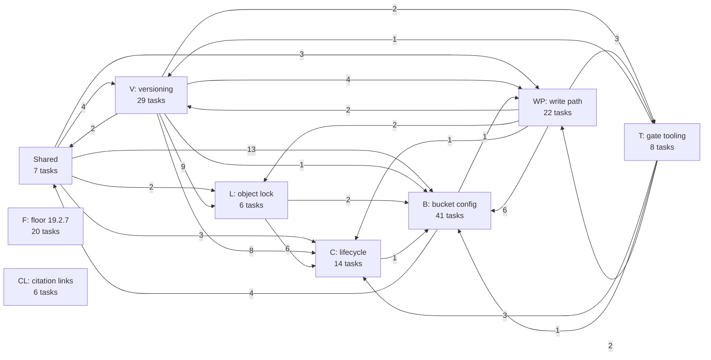
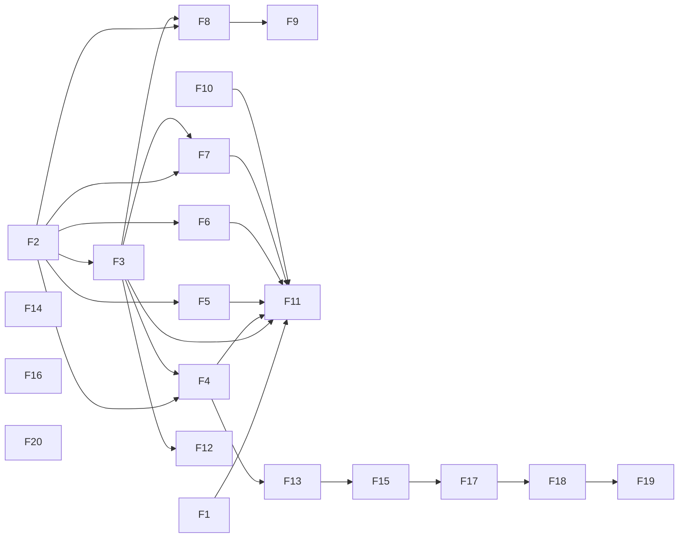
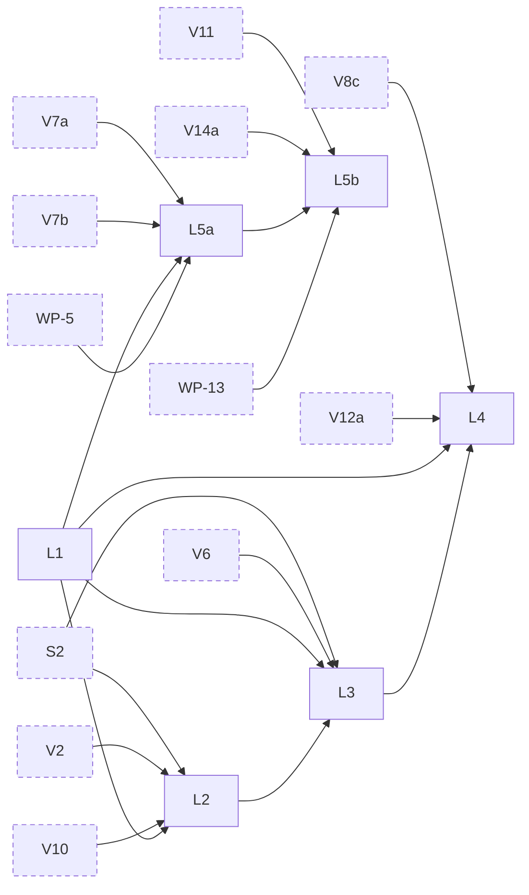
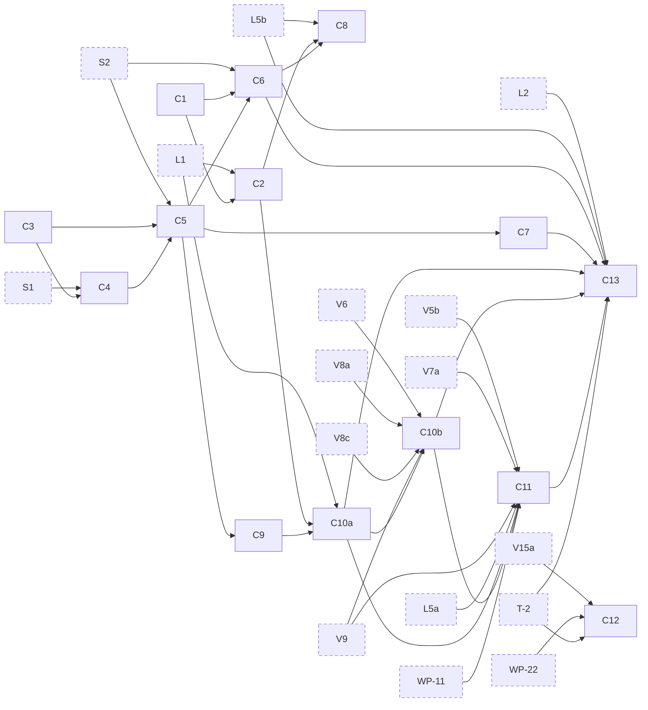
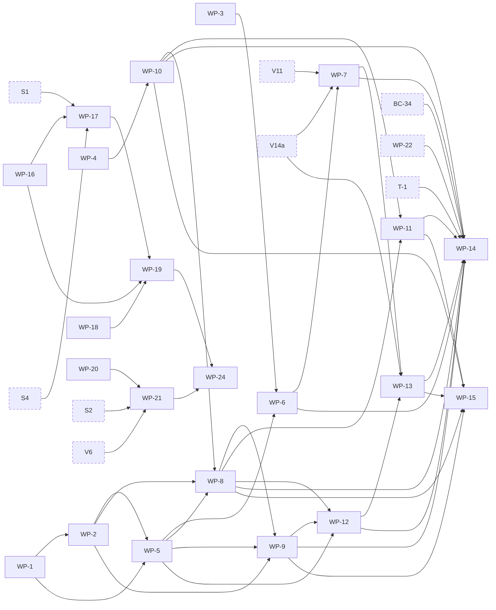
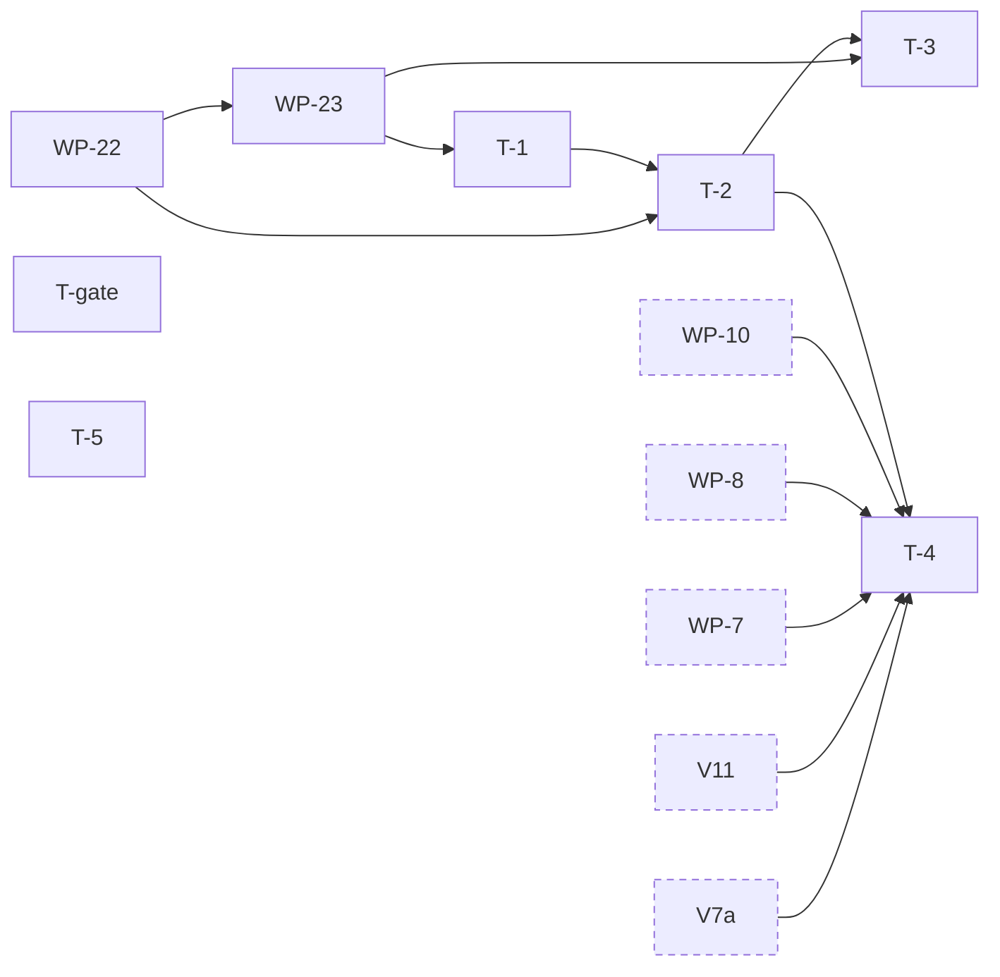
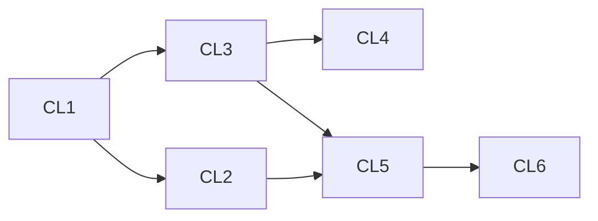

# Phase 2 task dependencies

Generated from every task's **Depends on:** line in the unit files at 33720b1. An arrow runs from a
prerequisite to the task that waits for it. In a unit's graph, a solid box is one of that unit's
tasks and a dashed box is a prerequisite from another unit; no colour carries meaning. Each box
links to its task where the Mermaid renderer allows clicks, and the list under each graph links
every one of the unit's tasks. A plan change that alters a Depends-on line regenerates this file.

### Units

Each arrow counts the dependencies from tasks of one unit on tasks of another.

### Shared

```mermaid
flowchart LR
  t_S1["S1"]
  t_S2["S2"]
  t_S3["S3"]
  t_S4["S4"]
  t_S5["S5"]
  t_S6["S6"]
  t_S7["S7"]
  t_V2["V2"]:::ext
  t_V10["V10"]:::ext
  t_BC_10["BC-10"]:::ext
  t_BC_17["BC-17"]:::ext
  t_BC_23["BC-23"]:::ext
  t_BC_28a["BC-28a"]:::ext
  t_S1 --> t_S4
  t_V2 --> t_S6
  t_V10 --> t_S7
  t_BC_10 --> t_S7
  t_BC_17 --> t_S7
  t_BC_23 --> t_S7
  t_BC_28a --> t_S7
  click t_S1 href "https://github.com/jhoblitt/rgw-go/blob/main/docs/superpowers/plans/2026-10-13-phase-2/00-index.md#task-s1-fakeradoss-rgw-class-as-method-tables" "S1: fakerados's rgw class as method tables"
  click t_S2 href "https://github.com/jhoblitt/rgw-go/blob/main/docs/superpowers/plans/2026-10-13-phase-2/00-index.md#task-s2-route-sets-per-feature-and-the-env-slots" "S2: route sets per feature and the Env slots"
  click t_S3 href "https://github.com/jhoblitt/rgw-go/blob/main/docs/superpowers/plans/2026-10-13-phase-2/00-index.md#task-s3-one-aws-correct-ispublic" "S3: one AWS-correct IsPublic"
  click t_S4 href "https://github.com/jhoblitt/rgw-go/blob/main/docs/superpowers/plans/2026-10-13-phase-2/00-index.md#task-s4-fakerados-refuses-an-unregistered-class-method-at-op-setup" "S4: fakerados refuses an unregistered class method at op setup"
  click t_S5 href "https://github.com/jhoblitt/rgw-go/blob/main/docs/superpowers/plans/2026-10-13-phase-2/00-index.md#task-s5-ignorepublicacls-ignores-swifts-public-container-grants" "S5: IgnorePublicAcls ignores Swift's public container grants"
  click t_S6 href "https://github.com/jhoblitt/rgw-go/blob/main/docs/superpowers/plans/2026-10-13-phase-2/00-index.md#task-s6-one-choose_from" "S6: one choose_from"
  click t_S7 href "https://github.com/jhoblitt/rgw-go/blob/main/docs/superpowers/plans/2026-10-13-phase-2/00-index.md#task-s7-one-schema-scanner-for-s3-xml-request-bodies" "S7: one schema scanner for S3 XML request bodies"
  click t_V2 href "https://github.com/jhoblitt/rgw-go/blob/main/docs/superpowers/plans/2026-10-13-phase-2/V-versioning.md#task-v2-meta-olh-head-types-and-bucket-helpers" "V2: meta OLH head types and bucket helpers"
  click t_V10 href "https://github.com/jhoblitt/rgw-go/blob/main/docs/superpowers/plans/2026-10-13-phase-2/V-versioning.md#task-v10-op-and-s3-putbucketversioning-and-getbucketversioning" "V10: op and s3, PutBucketVersioning and GetBucketVersioning"
  click t_BC_10 href "https://github.com/jhoblitt/rgw-go/blob/main/docs/superpowers/plans/2026-10-13-phase-2/B-bucket-config.md#task-bc-10-website-semantics-and-xml" "BC-10: Website semantics and XML"
  click t_BC_17 href "https://github.com/jhoblitt/rgw-go/blob/main/docs/superpowers/plans/2026-10-13-phase-2/B-bucket-config.md#task-bc-17-block-xml" "BC-17: Block XML"
  click t_BC_23 href "https://github.com/jhoblitt/rgw-go/blob/main/docs/superpowers/plans/2026-10-13-phase-2/B-bucket-config.md#task-bc-23-encryption-configuration-type" "BC-23: Encryption configuration type"
  click t_BC_28a href "https://github.com/jhoblitt/rgw-go/blob/main/docs/superpowers/plans/2026-10-13-phase-2/B-bucket-config.md#task-bc-28a-ownership-type" "BC-28a: Ownership type"
  classDef ext stroke-dasharray: 5 4
```

- [S1](00-index.md#task-s1-fakeradoss-rgw-class-as-method-tables): fakerados's rgw class as method tables
- [S2](00-index.md#task-s2-route-sets-per-feature-and-the-env-slots): route sets per feature and the Env slots
- [S3](00-index.md#task-s3-one-aws-correct-ispublic): one AWS-correct IsPublic
- [S4](00-index.md#task-s4-fakerados-refuses-an-unregistered-class-method-at-op-setup): fakerados refuses an unregistered class method at op setup
- [S5](00-index.md#task-s5-ignorepublicacls-ignores-swifts-public-container-grants): IgnorePublicAcls ignores Swift's public container grants
- [S6](00-index.md#task-s6-one-choose_from): one choose_from
- [S7](00-index.md#task-s7-one-schema-scanner-for-s3-xml-request-bodies): one schema scanner for S3 XML request bodies

### F: floor 19.2.7

- [F1](F-floor-19.2.7.md#task-f1-docs-the-specs-squid-floor-is-v1927): docs, the spec's Squid floor is v19.2.7
- [F2](F-floor-19.2.7.md#task-f2-docs-the-registry-at-v1927): docs, the registry at v19.2.7
- [F3](F-floor-19.2.7.md#task-f3-docs-the-exclusions-at-v1927): docs, the exclusions at v19.2.7
- [F4](F-floor-19.2.7.md#task-f4-auth-an-unsigned-content-type-and-x-amz-content-sha256-once-shown-safe): auth, an unsigned Content-Type and x-amz-content-sha256, once shown safe
- [F5](F-floor-19.2.7.md#task-f5-driver-a-re-sent-completion-answers-the-stored-etag-on-both-releases): driver, a re-sent completion answers the stored ETag on both releases
- [F6](F-floor-19.2.7.md#task-f6-memstore-the-same-for-the-in-memory-store): memstore, the same for the in-memory store
- [F7](F-floor-19.2.7.md#task-f7-driver-a-reshard-guard-that-meets-a-missing-shard-re-reads-the-bucket-and-retries): driver, a reshard guard that meets a missing shard re-reads the bucket and retries
- [F8](F-floor-19.2.7.md#task-f8-meta-rgwobjectlock-typed-and-the-bucket-instance-json-carries-obj_lock): meta, RGWObjectLock typed, and the bucket instance JSON carries obj_lock
- [F9](F-floor-19.2.7.md#task-f9-driver-a-bucket-instance-put-takes-a-documents-obj_lock): driver, a bucket instance put takes a document's obj_lock
- [F10](F-floor-19.2.7.md#task-f10-hackgoldens-v1927s-ceph-dencoder-by-default): hack/goldens, v19.2.7's ceph-dencoder by default
- [F11](F-floor-19.2.7.md#task-f11-ops-and-parity-squids-pin-bumped-and-radosgws-squid-ledgers-re-recorded): ops and parity, Squid's pin bumped and radosgw's Squid ledgers re-recorded
- [F12](F-floor-19.2.7.md#task-f12-driver-guardheads-instance-exemption-on-both-releases): driver, guardHead's instance exemption on both releases
- [F13](F-floor-19.2.7.md#task-f13-auth-every-prefix-init_meta_info-renames-must-be-signed): auth, every prefix init_meta_info renames must be signed
- [F14](F-floor-19.2.7.md#task-f14-op-a-completemultipartupload-naming-a-version-answers-501): op, a CompleteMultipartUpload naming a version answers 501
- [F15](F-floor-19.2.7.md#task-f15-auth-sigv2-refuses-a-renamed-header-carrying-an-x-amz-directive): auth, SigV2 refuses a renamed header carrying an x-amz directive
- [F16](F-floor-19.2.7.md#task-f16-s3-createbucket-reads-its-object-lock-header-from-the-renamed-map): s3, CreateBucket reads its object lock header from the renamed map
- [F17](F-floor-19.2.7.md#task-f17-auth-a-sigv2-presigned-request-means-the-same-wherever-its-headerquery-split-falls): auth, a SigV2 presigned request means the same wherever its header/query split falls
- [F18](F-floor-19.2.7.md#task-f18-auth-authz-and-s3-the-s3-api-reads-x-amz--headers-only): auth, authz and s3, the S3 API reads X-Amz- headers only
- [F19](F-floor-19.2.7.md#task-f19-auth-and-s3-a-header-signed-sigv2-request-takes-no-unsigned-query-metadata-or-encryption): auth and s3, a header-signed SigV2 request takes no unsigned query metadata or encryption
- [F20](F-floor-19.2.7.md#task-f20-s3-putobject-parses-partnumber-as-radosgw-does): s3, PutObject parses partNumber as radosgw does

### V: versioning

V15b depends on every task above; the chart draws only the tasks that line names one by one.

```mermaid
flowchart LR
  t_V0["V0"]
  t_V1["V1"]
  t_V2["V2"]
  t_V3a["V3a"]
  t_V3b["V3b"]
  t_V4["V4"]
  t_V5a["V5a"]
  t_V5b["V5b"]
  t_V5c["V5c"]
  t_V6["V6"]
  t_V7a["V7a"]
  t_V7b["V7b"]
  t_V8a["V8a"]
  t_V8c["V8c"]
  t_V8b["V8b"]
  t_V9["V9"]
  t_V10["V10"]
  t_V11["V11"]
  t_V12a["V12a"]
  t_V12b["V12b"]
  t_V13a["V13a"]
  t_V13b["V13b"]
  t_V13c["V13c"]
  t_V13d["V13d"]
  t_V14a["V14a"]
  t_V14b["V14b"]
  t_V15a["V15a"]
  t_V15b["V15b"]
  t_V15c["V15c"]
  t_S1["S1"]:::ext
  t_S2["S2"]:::ext
  t_WP_16["WP-16"]:::ext
  t_WP_17["WP-17"]:::ext
  t_WP_22["WP-22"]:::ext
  t_S1 --> t_V3a
  t_V0 --> t_V3a
  t_V1 --> t_V3a
  t_S1 --> t_V3b
  t_V1 --> t_V3b
  t_V1 --> t_V4
  t_V2 --> t_V4
  t_V3b --> t_V4
  t_V3a --> t_V5a
  t_V3b --> t_V5a
  t_V4 --> t_V5a
  t_V5a --> t_V5b
  t_V5b --> t_V5c
  t_V5b --> t_V6
  t_V5c --> t_V7a
  t_V6 --> t_V7a
  t_V7a --> t_V7b
  t_V5c --> t_V8a
  t_V6 --> t_V8a
  t_V5c --> t_V8c
  t_V8a --> t_V8c
  t_V8a --> t_V8b
  t_V9 --> t_V8b
  t_V0 --> t_V9
  t_V3a --> t_V9
  t_V5a --> t_V9
  t_S2 --> t_V10
  t_V2 --> t_V10
  t_V7a --> t_V11
  t_V7b --> t_V11
  t_V8a --> t_V12a
  t_V10 --> t_V12a
  t_V11 --> t_V12a
  t_V13d --> t_V12a
  t_V8b --> t_V12b
  t_WP_16 --> t_V13a
  t_V13a --> t_V13b
  t_WP_17 --> t_V13b
  t_V13a --> t_V13c
  t_V13b --> t_V13c
  t_S2 --> t_V13d
  t_V10 --> t_V13d
  t_V13c --> t_V13d
  t_V6 --> t_V14a
  t_V11 --> t_V14a
  t_V9 --> t_V14b
  t_V10 --> t_V15a
  t_V11 --> t_V15a
  t_V12a --> t_V15a
  t_V14a --> t_V15a
  t_V14b --> t_V15a
  t_WP_22 --> t_V15a
  t_V15a --> t_V15c
  t_V15b --> t_V15c
  click t_V0 href "https://github.com/jhoblitt/rgw-go/blob/main/docs/superpowers/plans/2026-10-13-phase-2/V-versioning.md#task-v0-a-failed-class-call-keeps-its-output" "V0: a failed class call keeps its output"
  click t_V1 href "https://github.com/jhoblitt/rgw-go/blob/main/docs/superpowers/plans/2026-10-13-phase-2/V-versioning.md#task-v1-clsrgw-olh-methods-bi_get-and-the-index-key-encoders" "V1: cls/rgw OLH methods, `bi_get` and the index key encoders"
  click t_V2 href "https://github.com/jhoblitt/rgw-go/blob/main/docs/superpowers/plans/2026-10-13-phase-2/V-versioning.md#task-v2-meta-olh-head-types-and-bucket-helpers" "V2: meta OLH head types and bucket helpers"
  click t_V3a href "https://github.com/jhoblitt/rgw-go/blob/main/docs/superpowers/plans/2026-10-13-phase-2/V-versioning.md#task-v3a-emulator-versioned-keys-in-the-index-methods" "V3a: emulator, versioned keys in the index methods"
  click t_V3b href "https://github.com/jhoblitt/rgw-go/blob/main/docs/superpowers/plans/2026-10-13-phase-2/V-versioning.md#task-v3b-emulator-the-olh-methods-bi_get-and-obj_check_attrs_prefix" "V3b: emulator, the OLH methods, `bi_get` and `obj_check_attrs_prefix`"
  click t_V4 href "https://github.com/jhoblitt/rgw-go/blob/main/docs/superpowers/plans/2026-10-13-phase-2/V-versioning.md#task-v4-driver-the-olh-head-operations" "V4: driver, the OLH head operations"
  click t_V5a href "https://github.com/jhoblitt/rgw-go/blob/main/docs/superpowers/plans/2026-10-13-phase-2/V-versioning.md#task-v5a-driver-the-olh-index-operations-and-the-awaited-completion" "V5a: driver, the OLH index operations and the awaited completion"
  click t_V5b href "https://github.com/jhoblitt/rgw-go/blob/main/docs/superpowers/plans/2026-10-13-phase-2/V-versioning.md#task-v5b-driver-setolh-unlinkobjinstance-and-the-races" "V5b: driver, `setOLH`, `unlinkObjInstance` and the races"
  click t_V5c href "https://github.com/jhoblitt/rgw-go/blob/main/docs/superpowers/plans/2026-10-13-phase-2/V-versioning.md#task-v5c-driver-conditional-links-d1-and-expecttag" "V5c: driver, conditional links (D1) and `ExpectTag`"
  click t_V6 href "https://github.com/jhoblitt/rgw-go/blob/main/docs/superpowers/plans/2026-10-13-phase-2/V-versioning.md#task-v6-driver-reads-follow-the-olh-attrs-on-a-version" "V6: driver, reads follow the OLH; attrs on a version"
  click t_V7a href "https://github.com/jhoblitt/rgw-go/blob/main/docs/superpowers/plans/2026-10-13-phase-2/V-versioning.md#task-v7a-driver-versioned-putobject" "V7a: driver, versioned PutObject"
  click t_V7b href "https://github.com/jhoblitt/rgw-go/blob/main/docs/superpowers/plans/2026-10-13-phase-2/V-versioning.md#task-v7b-driver-versioned-copyobject-and-completemultipartupload" "V7b: driver, versioned CopyObject and CompleteMultipartUpload"
  click t_V8a href "https://github.com/jhoblitt/rgw-go/blob/main/docs/superpowers/plans/2026-10-13-phase-2/V-versioning.md#task-v8a-driver-versioned-deleteobject" "V8a: driver, versioned DeleteObject"
  click t_V8c href "https://github.com/jhoblitt/rgw-go/blob/main/docs/superpowers/plans/2026-10-13-phase-2/V-versioning.md#task-v8c-driver-deleteparamsexpect" "V8c: driver, `DeleteParams.Expect`"
  click t_V8b href "https://github.com/jhoblitt/rgw-go/blob/main/docs/superpowers/plans/2026-10-13-phase-2/V-versioning.md#task-v8b-driver-the-admin-removals-on-versioned-buckets" "V8b: driver, the admin removals on versioned buckets"
  click t_V9 href "https://github.com/jhoblitt/rgw-go/blob/main/docs/superpowers/plans/2026-10-13-phase-2/V-versioning.md#task-v9-driver-listings-with-versions" "V9: driver, listings with versions"
  click t_V10 href "https://github.com/jhoblitt/rgw-go/blob/main/docs/superpowers/plans/2026-10-13-phase-2/V-versioning.md#task-v10-op-and-s3-putbucketversioning-and-getbucketversioning" "V10: op and s3, PutBucketVersioning and GetBucketVersioning"
  click t_V11 href "https://github.com/jhoblitt/rgw-go/blob/main/docs/superpowers/plans/2026-10-13-phase-2/V-versioning.md#task-v11-op-and-s3-versioned-writes" "V11: op and s3, versioned writes"
  click t_V12a href "https://github.com/jhoblitt/rgw-go/blob/main/docs/superpowers/plans/2026-10-13-phase-2/V-versioning.md#task-v12a-op-and-s3-versioned-deleteobject-and-deleteobjects" "V12a: op and s3, versioned DeleteObject and DeleteObjects"
  click t_V12b href "https://github.com/jhoblitt/rgw-go/blob/main/docs/superpowers/plans/2026-10-13-phase-2/V-versioning.md#task-v12b-admin-the-object-removal-and-the-purges-on-versioned-buckets" "V12b: admin, the object removal and the purges on versioned buckets"
  click t_V13a href "https://github.com/jhoblitt/rgw-go/blob/main/docs/superpowers/plans/2026-10-13-phase-2/V-versioning.md#task-v13a-clsotp-the-check-and-result-calls" "V13a: cls/otp, the check and result calls"
  click t_V13b href "https://github.com/jhoblitt/rgw-go/blob/main/docs/superpowers/plans/2026-10-13-phase-2/V-versioning.md#task-v13b-emulator-the-otp-check-methods" "V13b: emulator, the otp check methods"
  click t_V13c href "https://github.com/jhoblitt/rgw-go/blob/main/docs/superpowers/plans/2026-10-13-phase-2/V-versioning.md#task-v13c-driver-verifymfa" "V13c: driver, VerifyMFA"
  click t_V13d href "https://github.com/jhoblitt/rgw-go/blob/main/docs/superpowers/plans/2026-10-13-phase-2/V-versioning.md#task-v13d-op-and-s3-the-x-amz-mfa-header" "V13d: op and s3, the `x-amz-mfa` header"
  click t_V14a href "https://github.com/jhoblitt/rgw-go/blob/main/docs/superpowers/plans/2026-10-13-phase-2/V-versioning.md#task-v14a-op-and-s3-versioned-reads" "V14a: op and s3, versioned reads"
  click t_V14b href "https://github.com/jhoblitt/rgw-go/blob/main/docs/superpowers/plans/2026-10-13-phase-2/V-versioning.md#task-v14b-op-and-s3-listobjectversions" "V14b: op and s3, ListObjectVersions"
  click t_V15a href "https://github.com/jhoblitt/rgw-go/blob/main/docs/superpowers/plans/2026-10-13-phase-2/V-versioning.md#task-v15a-recording-the-versioning-s3-tests" "V15a: recording, the versioning s3-tests"
  click t_V15b href "https://github.com/jhoblitt/rgw-go/blob/main/docs/superpowers/plans/2026-10-13-phase-2/V-versioning.md#task-v15b-the-cross-gateway-cases" "V15b: the cross-gateway cases"
  click t_V15c href "https://github.com/jhoblitt/rgw-go/blob/main/docs/superpowers/plans/2026-10-13-phase-2/V-versioning.md#task-v15c-the-registry-after-the-gate" "V15c: the registry after the gate"
  click t_S1 href "https://github.com/jhoblitt/rgw-go/blob/main/docs/superpowers/plans/2026-10-13-phase-2/00-index.md#task-s1-fakeradoss-rgw-class-as-method-tables" "S1: fakerados's rgw class as method tables"
  click t_S2 href "https://github.com/jhoblitt/rgw-go/blob/main/docs/superpowers/plans/2026-10-13-phase-2/00-index.md#task-s2-route-sets-per-feature-and-the-env-slots" "S2: route sets per feature and the Env slots"
  click t_WP_16 href "https://github.com/jhoblitt/rgw-go/blob/main/docs/superpowers/plans/2026-10-13-phase-2/WP-write-path.md#task-wp-16-the-otp-class-client" "WP-16: the otp class client"
  click t_WP_17 href "https://github.com/jhoblitt/rgw-go/blob/main/docs/superpowers/plans/2026-10-13-phase-2/WP-write-path.md#task-wp-17-the-otp-class-emulator" "WP-17: the otp class emulator"
  click t_WP_22 href "https://github.com/jhoblitt/rgw-go/blob/main/docs/superpowers/plans/2026-10-13-phase-2/T-gate-tooling.md#task-wp-22-the-s3-tests-selection-in-go" "WP-22: the s3-tests selection in Go"
  classDef ext stroke-dasharray: 5 4
```

- [V0](V-versioning.md#task-v0-a-failed-class-call-keeps-its-output): a failed class call keeps its output
- [V1](V-versioning.md#task-v1-clsrgw-olh-methods-bi_get-and-the-index-key-encoders): cls/rgw OLH methods, `bi_get` and the index key encoders
- [V2](V-versioning.md#task-v2-meta-olh-head-types-and-bucket-helpers): meta OLH head types and bucket helpers
- [V3a](V-versioning.md#task-v3a-emulator-versioned-keys-in-the-index-methods): emulator, versioned keys in the index methods
- [V3b](V-versioning.md#task-v3b-emulator-the-olh-methods-bi_get-and-obj_check_attrs_prefix): emulator, the OLH methods, `bi_get` and `obj_check_attrs_prefix`
- [V4](V-versioning.md#task-v4-driver-the-olh-head-operations): driver, the OLH head operations
- [V5a](V-versioning.md#task-v5a-driver-the-olh-index-operations-and-the-awaited-completion): driver, the OLH index operations and the awaited completion
- [V5b](V-versioning.md#task-v5b-driver-setolh-unlinkobjinstance-and-the-races): driver, `setOLH`, `unlinkObjInstance` and the races
- [V5c](V-versioning.md#task-v5c-driver-conditional-links-d1-and-expecttag): driver, conditional links (D1) and `ExpectTag`
- [V6](V-versioning.md#task-v6-driver-reads-follow-the-olh-attrs-on-a-version): driver, reads follow the OLH; attrs on a version
- [V7a](V-versioning.md#task-v7a-driver-versioned-putobject): driver, versioned PutObject
- [V7b](V-versioning.md#task-v7b-driver-versioned-copyobject-and-completemultipartupload): driver, versioned CopyObject and CompleteMultipartUpload
- [V8a](V-versioning.md#task-v8a-driver-versioned-deleteobject): driver, versioned DeleteObject
- [V8c](V-versioning.md#task-v8c-driver-deleteparamsexpect): driver, `DeleteParams.Expect`
- [V8b](V-versioning.md#task-v8b-driver-the-admin-removals-on-versioned-buckets): driver, the admin removals on versioned buckets
- [V9](V-versioning.md#task-v9-driver-listings-with-versions): driver, listings with versions
- [V10](V-versioning.md#task-v10-op-and-s3-putbucketversioning-and-getbucketversioning): op and s3, PutBucketVersioning and GetBucketVersioning
- [V11](V-versioning.md#task-v11-op-and-s3-versioned-writes): op and s3, versioned writes
- [V12a](V-versioning.md#task-v12a-op-and-s3-versioned-deleteobject-and-deleteobjects): op and s3, versioned DeleteObject and DeleteObjects
- [V12b](V-versioning.md#task-v12b-admin-the-object-removal-and-the-purges-on-versioned-buckets): admin, the object removal and the purges on versioned buckets
- [V13a](V-versioning.md#task-v13a-clsotp-the-check-and-result-calls): cls/otp, the check and result calls
- [V13b](V-versioning.md#task-v13b-emulator-the-otp-check-methods): emulator, the otp check methods
- [V13c](V-versioning.md#task-v13c-driver-verifymfa): driver, VerifyMFA
- [V13d](V-versioning.md#task-v13d-op-and-s3-the-x-amz-mfa-header): op and s3, the `x-amz-mfa` header
- [V14a](V-versioning.md#task-v14a-op-and-s3-versioned-reads): op and s3, versioned reads
- [V14b](V-versioning.md#task-v14b-op-and-s3-listobjectversions): op and s3, ListObjectVersions
- [V15a](V-versioning.md#task-v15a-recording-the-versioning-s3-tests): recording, the versioning s3-tests
- [V15b](V-versioning.md#task-v15b-the-cross-gateway-cases): the cross-gateway cases
- [V15c](V-versioning.md#task-v15c-the-registry-after-the-gate): the registry after the gate

### L: object lock

- [L1](L-object-lock.md#task-l1-object-lock-types-xml-dates-and-evaluation): object-lock types, XML, dates and evaluation
- [L2](L-object-lock.md#task-l2-bucket-object-lock-configuration-and-createbucket-with-lock): bucket object-lock configuration, and CreateBucket with lock
- [L3](L-object-lock.md#task-l3-object-retention-and-legal-hold): object retention and legal hold
- [L4](L-object-lock.md#task-l4-delete-enforcement): delete enforcement
- [L5a](L-object-lock.md#task-l5a-the-lock-on-the-write-path-driver): the lock on the write path, driver
- [L5b](L-object-lock.md#task-l5b-the-lock-headers-op-and-s3): the lock headers, op and S3

### C: lifecycle

- [C1](C-lifecycle.md#task-c1-lifecycle-types-encodings-and-xml): lifecycle types, encodings and XML
- [C2](C-lifecycle.md#task-c2-lifecycle-evaluation): lifecycle evaluation
- [C3](C-lifecycle.md#task-c3-the-cls_rgw-lc-client): the cls_rgw lc client
- [C4](C-lifecycle.md#task-c4-the-fakerados-lc-methods): the fakerados lc methods
- [C5](C-lifecycle.md#task-c5-the-lc-shard-store-and-the-options): the lc shard store and the options
- [C6](C-lifecycle.md#task-c6-the-lifecycle-configuration-ops): the lifecycle configuration ops
- [C7](C-lifecycle.md#task-c7-the-lc-entrys-side-effects): the lc entry's side effects
- [C8](C-lifecycle.md#task-c8-the-lifecycle-response-headers): the lifecycle response headers
- [C9](C-lifecycle.md#task-c9-the-worker-the-shard-protocol): the worker, the shard protocol
- [C10a](C-lifecycle.md#task-c10a-the-worker-on-unversioned-buckets-and-the-multipart-abort): the worker on unversioned buckets, and the multipart abort
- [C10b](C-lifecycle.md#task-c10b-the-worker-on-versioned-buckets): the worker on versioned buckets
- [C11](C-lifecycle.md#task-c11-in-cluster-transition): in-cluster transition
- [C12](C-lifecycle.md#task-c12-the-lifecycle-and-object-lock-parity-set): the lifecycle and object-lock parity set
- [C13](C-lifecycle.md#task-c13-the-cross-gateway-and-mixed-worker-gates): the cross-gateway and mixed-worker gates

### B: bucket config

```mermaid
flowchart LR
  t_BC_2["BC-2"]
  t_BC_3["BC-3"]
  t_BC_4["BC-4"]
  t_BC_5["BC-5"]
  t_BC_6["BC-6"]
  t_BC_7["BC-7"]
  t_BC_8["BC-8"]
  t_BC_9["BC-9"]
  t_BC_10["BC-10"]
  t_BC_11["BC-11"]
  t_BC_12["BC-12"]
  t_BC_13["BC-13"]
  t_BC_14["BC-14"]
  t_BC_15["BC-15"]
  t_BC_13c["BC-13c"]
  t_BC_16["BC-16"]
  t_BC_17["BC-17"]
  t_BC_18["BC-18"]
  t_BC_19["BC-19"]
  t_BC_20["BC-20"]
  t_BC_21["BC-21"]
  t_BC_22["BC-22"]
  t_BC_23["BC-23"]
  t_BC_24["BC-24"]
  t_BC_25["BC-25"]
  t_BC_26["BC-26"]
  t_BC_27["BC-27"]
  t_BC_28a["BC-28a"]
  t_BC_28b["BC-28b"]
  t_BC_28c["BC-28c"]
  t_BC_28d["BC-28d"]
  t_BC_28e["BC-28e"]
  t_BC_28f["BC-28f"]
  t_BC_29["BC-29"]
  t_BC_30["BC-30"]
  t_BC_30b["BC-30b"]
  t_BC_31["BC-31"]
  t_BC_32["BC-32"]
  t_BC_33["BC-33"]
  t_BC_34["BC-34"]
  t_BC_35["BC-35"]
  t_S2["S2"]:::ext
  t_S3["S3"]:::ext
  t_S5["S5"]:::ext
  t_V11["V11"]:::ext
  t_L1["L1"]:::ext
  t_L5b["L5b"]:::ext
  t_C8["C8"]:::ext
  t_WP_1["WP-1"]:::ext
  t_WP_5["WP-5"]:::ext
  t_WP_6["WP-6"]:::ext
  t_WP_7["WP-7"]:::ext
  t_WP_13["WP-13"]:::ext
  t_WP_23["WP-23"]:::ext
  t_BC_2 --> t_BC_3
  t_BC_5 --> t_BC_3
  t_BC_2 --> t_BC_4
  t_BC_3 --> t_BC_4
  t_S2 --> t_BC_6
  t_BC_3 --> t_BC_6
  t_BC_5 --> t_BC_6
  t_BC_7 --> t_BC_6
  t_BC_2 --> t_BC_7
  t_BC_3 --> t_BC_7
  t_BC_3 --> t_BC_8
  t_BC_4 --> t_BC_8
  t_BC_5 --> t_BC_8
  t_BC_6 --> t_BC_8
  t_BC_7 --> t_BC_8
  t_BC_9 --> t_BC_10
  t_BC_9 --> t_BC_11
  t_S2 --> t_BC_12
  t_BC_10 --> t_BC_12
  t_BC_11 --> t_BC_12
  t_BC_10 --> t_BC_14
  t_BC_13 --> t_BC_14
  t_S2 --> t_BC_15
  t_BC_12 --> t_BC_15
  t_BC_14 --> t_BC_15
  t_S3 --> t_BC_13c
  t_BC_13 --> t_BC_13c
  t_BC_15 --> t_BC_13c
  t_BC_9 --> t_BC_16
  t_BC_10 --> t_BC_16
  t_BC_11 --> t_BC_16
  t_BC_12 --> t_BC_16
  t_BC_13 --> t_BC_16
  t_BC_14 --> t_BC_16
  t_BC_15 --> t_BC_16
  t_BC_13c --> t_BC_16
  t_S3 --> t_BC_18
  t_S5 --> t_BC_18
  t_BC_17 --> t_BC_18
  t_S2 --> t_BC_19
  t_BC_18 --> t_BC_19
  t_S3 --> t_BC_20
  t_S2 --> t_BC_21
  t_BC_20 --> t_BC_21
  t_BC_17 --> t_BC_22
  t_BC_18 --> t_BC_22
  t_BC_19 --> t_BC_22
  t_BC_20 --> t_BC_22
  t_BC_21 --> t_BC_22
  t_BC_23 --> t_BC_24
  t_S2 --> t_BC_25
  t_BC_24 --> t_BC_25
  t_V11 --> t_BC_26
  t_L5b --> t_BC_26
  t_C8 --> t_BC_26
  t_BC_23 --> t_BC_26
  t_BC_27 --> t_BC_26
  t_WP_6 --> t_BC_26
  t_WP_7 --> t_BC_26
  t_WP_13 --> t_BC_26
  t_BC_23 --> t_BC_27
  t_BC_24 --> t_BC_27
  t_BC_25 --> t_BC_27
  t_BC_26 --> t_BC_27
  t_WP_23 --> t_BC_27
  t_BC_28a --> t_BC_28c
  t_S2 --> t_BC_28d
  t_BC_28b --> t_BC_28d
  t_BC_28c --> t_BC_28d
  t_S3 --> t_BC_28e
  t_BC_28a --> t_BC_28e
  t_BC_32 --> t_BC_28e
  t_BC_28a --> t_BC_28f
  t_BC_28e --> t_BC_28f
  t_BC_30 --> t_BC_29
  t_WP_1 --> t_BC_30
  t_L1 --> t_BC_30b
  t_BC_30 --> t_BC_30b
  t_BC_26 --> t_BC_32
  t_BC_30 --> t_BC_32
  t_BC_31 --> t_BC_32
  t_WP_5 --> t_BC_32
  t_WP_6 --> t_BC_32
  t_S2 --> t_BC_33
  t_BC_29 --> t_BC_33
  t_BC_32 --> t_BC_33
  t_BC_29 --> t_BC_34
  t_BC_30 --> t_BC_34
  t_BC_31 --> t_BC_34
  t_BC_32 --> t_BC_34
  t_BC_33 --> t_BC_34
  t_BC_3 --> t_BC_35
  t_BC_11 --> t_BC_35
  t_BC_18 --> t_BC_35
  t_BC_24 --> t_BC_35
  t_BC_28c --> t_BC_35
  click t_BC_2 href "https://github.com/jhoblitt/rgw-go/blob/main/docs/superpowers/plans/2026-10-13-phase-2/B-bucket-config.md#task-bc-2-cors-types" "BC-2: CORS types"
  click t_BC_3 href "https://github.com/jhoblitt/rgw-go/blob/main/docs/superpowers/plans/2026-10-13-phase-2/B-bucket-config.md#task-bc-3-cors-ops" "BC-3: CORS ops"
  click t_BC_4 href "https://github.com/jhoblitt/rgw-go/blob/main/docs/superpowers/plans/2026-10-13-phase-2/B-bucket-config.md#task-bc-4-the-non-preflight-cors-refusal" "BC-4: The non-preflight CORS refusal"
  click t_BC_5 href "https://github.com/jhoblitt/rgw-go/blob/main/docs/superpowers/plans/2026-10-13-phase-2/B-bucket-config.md#task-bc-5-preflight-signing" "BC-5: Preflight signing"
  click t_BC_6 href "https://github.com/jhoblitt/rgw-go/blob/main/docs/superpowers/plans/2026-10-13-phase-2/B-bucket-config.md#task-bc-6-cors-routes" "BC-6: CORS routes"
  click t_BC_7 href "https://github.com/jhoblitt/rgw-go/blob/main/docs/superpowers/plans/2026-10-13-phase-2/B-bucket-config.md#task-bc-7-cors-headers-on-responses" "BC-7: CORS headers on responses"
  click t_BC_8 href "https://github.com/jhoblitt/rgw-go/blob/main/docs/superpowers/plans/2026-10-13-phase-2/B-bucket-config.md#task-bc-8-cors-recording-and-gate" "BC-8: CORS recording and gate"
  click t_BC_9 href "https://github.com/jhoblitt/rgw-go/blob/main/docs/superpowers/plans/2026-10-13-phase-2/B-bucket-config.md#task-bc-9-website-configuration-type" "BC-9: Website configuration type"
  click t_BC_10 href "https://github.com/jhoblitt/rgw-go/blob/main/docs/superpowers/plans/2026-10-13-phase-2/B-bucket-config.md#task-bc-10-website-semantics-and-xml" "BC-10: Website semantics and XML"
  click t_BC_11 href "https://github.com/jhoblitt/rgw-go/blob/main/docs/superpowers/plans/2026-10-13-phase-2/B-bucket-config.md#task-bc-11-website-configuration-ops" "BC-11: Website configuration ops"
  click t_BC_12 href "https://github.com/jhoblitt/rgw-go/blob/main/docs/superpowers/plans/2026-10-13-phase-2/B-bucket-config.md#task-bc-12-website-configuration-routes" "BC-12: Website configuration routes"
  click t_BC_13 href "https://github.com/jhoblitt/rgw-go/blob/main/docs/superpowers/plans/2026-10-13-phase-2/B-bucket-config.md#task-bc-13-website-requests" "BC-13: Website requests"
  click t_BC_14 href "https://github.com/jhoblitt/rgw-go/blob/main/docs/superpowers/plans/2026-10-13-phase-2/B-bucket-config.md#task-bc-14-website-retarget" "BC-14: Website retarget"
  click t_BC_15 href "https://github.com/jhoblitt/rgw-go/blob/main/docs/superpowers/plans/2026-10-13-phase-2/B-bucket-config.md#task-bc-15-website-serving-and-errors" "BC-15: Website serving and errors"
  click t_BC_13c href "https://github.com/jhoblitt/rgw-go/blob/main/docs/superpowers/plans/2026-10-13-phase-2/B-bucket-config.md#task-bc-13c-website-wiring" "BC-13c: Website wiring"
  click t_BC_16 href "https://github.com/jhoblitt/rgw-go/blob/main/docs/superpowers/plans/2026-10-13-phase-2/B-bucket-config.md#task-bc-16-website-gate" "BC-16: Website gate"
  click t_BC_17 href "https://github.com/jhoblitt/rgw-go/blob/main/docs/superpowers/plans/2026-10-13-phase-2/B-bucket-config.md#task-bc-17-block-xml" "BC-17: Block XML"
  click t_BC_18 href "https://github.com/jhoblitt/rgw-go/blob/main/docs/superpowers/plans/2026-10-13-phase-2/B-bucket-config.md#task-bc-18-block-ops" "BC-18: Block ops"
  click t_BC_19 href "https://github.com/jhoblitt/rgw-go/blob/main/docs/superpowers/plans/2026-10-13-phase-2/B-bucket-config.md#task-bc-19-block-routes" "BC-19: Block routes"
  click t_BC_20 href "https://github.com/jhoblitt/rgw-go/blob/main/docs/superpowers/plans/2026-10-13-phase-2/B-bucket-config.md#task-bc-20-policy-status-op" "BC-20: Policy status op"
  click t_BC_21 href "https://github.com/jhoblitt/rgw-go/blob/main/docs/superpowers/plans/2026-10-13-phase-2/B-bucket-config.md#task-bc-21-policy-status-route" "BC-21: Policy status route"
  click t_BC_22 href "https://github.com/jhoblitt/rgw-go/blob/main/docs/superpowers/plans/2026-10-13-phase-2/B-bucket-config.md#task-bc-22-block-and-policy-status-recording-and-gate" "BC-22: Block and policy-status recording and gate"
  click t_BC_23 href "https://github.com/jhoblitt/rgw-go/blob/main/docs/superpowers/plans/2026-10-13-phase-2/B-bucket-config.md#task-bc-23-encryption-configuration-type" "BC-23: Encryption configuration type"
  click t_BC_24 href "https://github.com/jhoblitt/rgw-go/blob/main/docs/superpowers/plans/2026-10-13-phase-2/B-bucket-config.md#task-bc-24-encryption-configuration-ops" "BC-24: Encryption configuration ops"
  click t_BC_25 href "https://github.com/jhoblitt/rgw-go/blob/main/docs/superpowers/plans/2026-10-13-phase-2/B-bucket-config.md#task-bc-25-encryption-configuration-routes" "BC-25: Encryption configuration routes"
  click t_BC_26 href "https://github.com/jhoblitt/rgw-go/blob/main/docs/superpowers/plans/2026-10-13-phase-2/B-bucket-config.md#task-bc-26-the-default-on-writes" "BC-26: The default on writes"
  click t_BC_27 href "https://github.com/jhoblitt/rgw-go/blob/main/docs/superpowers/plans/2026-10-13-phase-2/B-bucket-config.md#task-bc-27-encryption-recording-and-gate" "BC-27: Encryption recording and gate"
  click t_BC_28a href "https://github.com/jhoblitt/rgw-go/blob/main/docs/superpowers/plans/2026-10-13-phase-2/B-bucket-config.md#task-bc-28a-ownership-type" "BC-28a: Ownership type"
  click t_BC_28b href "https://github.com/jhoblitt/rgw-go/blob/main/docs/superpowers/plans/2026-10-13-phase-2/B-bucket-config.md#task-bc-28b-ownership-dispatch" "BC-28b: Ownership dispatch"
  click t_BC_28c href "https://github.com/jhoblitt/rgw-go/blob/main/docs/superpowers/plans/2026-10-13-phase-2/B-bucket-config.md#task-bc-28c-ownership-ops" "BC-28c: Ownership ops"
  click t_BC_28d href "https://github.com/jhoblitt/rgw-go/blob/main/docs/superpowers/plans/2026-10-13-phase-2/B-bucket-config.md#task-bc-28d-ownership-routes" "BC-28d: Ownership routes"
  click t_BC_28e href "https://github.com/jhoblitt/rgw-go/blob/main/docs/superpowers/plans/2026-10-13-phase-2/B-bucket-config.md#task-bc-28e-ownership-enforcement" "BC-28e: Ownership enforcement"
  click t_BC_28f href "https://github.com/jhoblitt/rgw-go/blob/main/docs/superpowers/plans/2026-10-13-phase-2/B-bucket-config.md#task-bc-28f-ownership-recording" "BC-28f: Ownership recording"
  click t_BC_29 href "https://github.com/jhoblitt/rgw-go/blob/main/docs/superpowers/plans/2026-10-13-phase-2/B-bucket-config.md#task-bc-29-form-reader" "BC-29: Form reader"
  click t_BC_30 href "https://github.com/jhoblitt/rgw-go/blob/main/docs/superpowers/plans/2026-10-13-phase-2/B-bucket-config.md#task-bc-30-post-policy-document" "BC-30: POST policy document"
  click t_BC_30b href "https://github.com/jhoblitt/rgw-go/blob/main/docs/superpowers/plans/2026-10-13-phase-2/B-bucket-config.md#task-bc-30b-one-parse_iso8601-and-one-json_spirit-reader" "BC-30b: One parse_iso8601 and one json_spirit reader"
  click t_BC_31 href "https://github.com/jhoblitt/rgw-go/blob/main/docs/superpowers/plans/2026-10-13-phase-2/B-bucket-config.md#task-bc-31-browser-upload-credentials" "BC-31: Browser-upload credentials"
  click t_BC_32 href "https://github.com/jhoblitt/rgw-go/blob/main/docs/superpowers/plans/2026-10-13-phase-2/B-bucket-config.md#task-bc-32-post-object-op" "BC-32: POST object op"
  click t_BC_33 href "https://github.com/jhoblitt/rgw-go/blob/main/docs/superpowers/plans/2026-10-13-phase-2/B-bucket-config.md#task-bc-33-post-object-routes" "BC-33: POST object routes"
  click t_BC_34 href "https://github.com/jhoblitt/rgw-go/blob/main/docs/superpowers/plans/2026-10-13-phase-2/B-bucket-config.md#task-bc-34-post-recording-and-gate" "BC-34: POST recording and gate"
  click t_BC_35 href "https://github.com/jhoblitt/rgw-go/blob/main/docs/superpowers/plans/2026-10-13-phase-2/B-bucket-config.md#task-bc-35-retitle-the-re-authorized-retries-exclusion" "BC-35: Retitle the re-authorized-retries exclusion"
  click t_S2 href "https://github.com/jhoblitt/rgw-go/blob/main/docs/superpowers/plans/2026-10-13-phase-2/00-index.md#task-s2-route-sets-per-feature-and-the-env-slots" "S2: route sets per feature and the Env slots"
  click t_S3 href "https://github.com/jhoblitt/rgw-go/blob/main/docs/superpowers/plans/2026-10-13-phase-2/00-index.md#task-s3-one-aws-correct-ispublic" "S3: one AWS-correct IsPublic"
  click t_S5 href "https://github.com/jhoblitt/rgw-go/blob/main/docs/superpowers/plans/2026-10-13-phase-2/00-index.md#task-s5-ignorepublicacls-ignores-swifts-public-container-grants" "S5: IgnorePublicAcls ignores Swift's public container grants"
  click t_V11 href "https://github.com/jhoblitt/rgw-go/blob/main/docs/superpowers/plans/2026-10-13-phase-2/V-versioning.md#task-v11-op-and-s3-versioned-writes" "V11: op and s3, versioned writes"
  click t_L1 href "https://github.com/jhoblitt/rgw-go/blob/main/docs/superpowers/plans/2026-10-13-phase-2/L-object-lock.md#task-l1-object-lock-types-xml-dates-and-evaluation" "L1: object-lock types, XML, dates and evaluation"
  click t_L5b href "https://github.com/jhoblitt/rgw-go/blob/main/docs/superpowers/plans/2026-10-13-phase-2/L-object-lock.md#task-l5b-the-lock-headers-op-and-s3" "L5b: the lock headers, op and S3"
  click t_C8 href "https://github.com/jhoblitt/rgw-go/blob/main/docs/superpowers/plans/2026-10-13-phase-2/C-lifecycle.md#task-c8-the-lifecycle-response-headers" "C8: the lifecycle response headers"
  click t_WP_1 href "https://github.com/jhoblitt/rgw-go/blob/main/docs/superpowers/plans/2026-10-13-phase-2/WP-write-path.md#task-wp-1-checksum-types-and-record" "WP-1: checksum types and record"
  click t_WP_5 href "https://github.com/jhoblitt/rgw-go/blob/main/docs/superpowers/plans/2026-10-13-phase-2/WP-write-path.md#task-wp-5-the-checksum-contract-on-the-op-and-store-seams" "WP-5: the checksum contract on the op and store seams"
  click t_WP_6 href "https://github.com/jhoblitt/rgw-go/blob/main/docs/superpowers/plans/2026-10-13-phase-2/WP-write-path.md#task-wp-6-checksum-requests" "WP-6: checksum requests"
  click t_WP_7 href "https://github.com/jhoblitt/rgw-go/blob/main/docs/superpowers/plans/2026-10-13-phase-2/WP-write-path.md#task-wp-7-checksum-headers-on-writes" "WP-7: checksum headers on writes"
  click t_WP_13 href "https://github.com/jhoblitt/rgw-go/blob/main/docs/superpowers/plans/2026-10-13-phase-2/WP-write-path.md#task-wp-13-checksum-rendering-on-reads" "WP-13: checksum rendering on reads"
  click t_WP_23 href "https://github.com/jhoblitt/rgw-go/blob/main/docs/superpowers/plans/2026-10-13-phase-2/T-gate-tooling.md#task-wp-23-the-include-list" "WP-23: the include list"
  classDef ext stroke-dasharray: 5 4
```

- [BC-2](B-bucket-config.md#task-bc-2-cors-types): CORS types
- [BC-3](B-bucket-config.md#task-bc-3-cors-ops): CORS ops
- [BC-4](B-bucket-config.md#task-bc-4-the-non-preflight-cors-refusal): The non-preflight CORS refusal
- [BC-5](B-bucket-config.md#task-bc-5-preflight-signing): Preflight signing
- [BC-6](B-bucket-config.md#task-bc-6-cors-routes): CORS routes
- [BC-7](B-bucket-config.md#task-bc-7-cors-headers-on-responses): CORS headers on responses
- [BC-8](B-bucket-config.md#task-bc-8-cors-recording-and-gate): CORS recording and gate
- [BC-9](B-bucket-config.md#task-bc-9-website-configuration-type): Website configuration type
- [BC-10](B-bucket-config.md#task-bc-10-website-semantics-and-xml): Website semantics and XML
- [BC-11](B-bucket-config.md#task-bc-11-website-configuration-ops): Website configuration ops
- [BC-12](B-bucket-config.md#task-bc-12-website-configuration-routes): Website configuration routes
- [BC-13](B-bucket-config.md#task-bc-13-website-requests): Website requests
- [BC-14](B-bucket-config.md#task-bc-14-website-retarget): Website retarget
- [BC-15](B-bucket-config.md#task-bc-15-website-serving-and-errors): Website serving and errors
- [BC-13c](B-bucket-config.md#task-bc-13c-website-wiring): Website wiring
- [BC-16](B-bucket-config.md#task-bc-16-website-gate): Website gate
- [BC-17](B-bucket-config.md#task-bc-17-block-xml): Block XML
- [BC-18](B-bucket-config.md#task-bc-18-block-ops): Block ops
- [BC-19](B-bucket-config.md#task-bc-19-block-routes): Block routes
- [BC-20](B-bucket-config.md#task-bc-20-policy-status-op): Policy status op
- [BC-21](B-bucket-config.md#task-bc-21-policy-status-route): Policy status route
- [BC-22](B-bucket-config.md#task-bc-22-block-and-policy-status-recording-and-gate): Block and policy-status recording and gate
- [BC-23](B-bucket-config.md#task-bc-23-encryption-configuration-type): Encryption configuration type
- [BC-24](B-bucket-config.md#task-bc-24-encryption-configuration-ops): Encryption configuration ops
- [BC-25](B-bucket-config.md#task-bc-25-encryption-configuration-routes): Encryption configuration routes
- [BC-26](B-bucket-config.md#task-bc-26-the-default-on-writes): The default on writes
- [BC-27](B-bucket-config.md#task-bc-27-encryption-recording-and-gate): Encryption recording and gate
- [BC-28a](B-bucket-config.md#task-bc-28a-ownership-type): Ownership type
- [BC-28b](B-bucket-config.md#task-bc-28b-ownership-dispatch): Ownership dispatch
- [BC-28c](B-bucket-config.md#task-bc-28c-ownership-ops): Ownership ops
- [BC-28d](B-bucket-config.md#task-bc-28d-ownership-routes): Ownership routes
- [BC-28e](B-bucket-config.md#task-bc-28e-ownership-enforcement): Ownership enforcement
- [BC-28f](B-bucket-config.md#task-bc-28f-ownership-recording): Ownership recording
- [BC-29](B-bucket-config.md#task-bc-29-form-reader): Form reader
- [BC-30](B-bucket-config.md#task-bc-30-post-policy-document): POST policy document
- [BC-30b](B-bucket-config.md#task-bc-30b-one-parse_iso8601-and-one-json_spirit-reader): One parse_iso8601 and one json_spirit reader
- [BC-31](B-bucket-config.md#task-bc-31-browser-upload-credentials): Browser-upload credentials
- [BC-32](B-bucket-config.md#task-bc-32-post-object-op): POST object op
- [BC-33](B-bucket-config.md#task-bc-33-post-object-routes): POST object routes
- [BC-34](B-bucket-config.md#task-bc-34-post-recording-and-gate): POST recording and gate
- [BC-35](B-bucket-config.md#task-bc-35-retitle-the-re-authorized-retries-exclusion): Retitle the re-authorized-retries exclusion

### WP: write path

- [WP-1](WP-write-path.md#task-wp-1-checksum-types-and-record): checksum types and record
- [WP-2](WP-write-path.md#task-wp-2-digests-and-combiners): digests and combiners
- [WP-3](WP-write-path.md#task-wp-3-trailer-values): trailer values
- [WP-4](WP-write-path.md#task-wp-4-block-encoders): block encoders
- [WP-5](WP-write-path.md#task-wp-5-the-checksum-contract-on-the-op-and-store-seams): the checksum contract on the op and store seams
- [WP-6](WP-write-path.md#task-wp-6-checksum-requests): checksum requests
- [WP-7](WP-write-path.md#task-wp-7-checksum-headers-on-writes): checksum headers on writes
- [WP-8](WP-write-path.md#task-wp-8-put-and-part-checksums): PUT and part checksums
- [WP-9](WP-write-path.md#task-wp-9-multipart-checksums): multipart checksums
- [WP-10](WP-write-path.md#task-wp-10-compression-on-put-and-parts): compression on PUT and parts
- [WP-11](WP-write-path.md#task-wp-11-copies): copies
- [WP-12](WP-write-path.md#task-wp-12-checksum-rules-on-reads): checksum rules on reads
- [WP-13](WP-write-path.md#task-wp-13-checksum-rendering-on-reads): checksum rendering on reads
- [WP-14](WP-write-path.md#task-wp-14-checksum-parity): checksum parity
- [WP-15](WP-write-path.md#task-wp-15-compression-and-checksum-gate): compression and checksum gate
- [WP-16](WP-write-path.md#task-wp-16-the-otp-class-client): the otp class client
- [WP-17](WP-write-path.md#task-wp-17-the-otp-class-emulator): the otp class emulator
- [WP-18](WP-write-path.md#task-wp-18-metadata-sections-as-tables): metadata sections as tables
- [WP-19](WP-write-path.md#task-wp-19-the-otp-metadata-section): the otp metadata section
- [WP-20](WP-write-path.md#task-wp-20-object-layout): object layout
- [WP-21](WP-write-path.md#task-wp-21-get-layout): GET `?layout`
- [WP-24](WP-write-path.md#task-wp-24-layout-and-otp-gate): `?layout` and otp gate

### T: gate tooling

T-gate depends on every task of every unit; the chart draws only the tasks that line names one by one.

- [WP-22](T-gate-tooling.md#task-wp-22-the-s3-tests-selection-in-go): the s3-tests selection in Go
- [WP-23](T-gate-tooling.md#task-wp-23-the-include-list): the include list
- [T-1](T-gate-tooling.md#task-t-1-the-per-pr-and-gate-sets): the per-PR and gate sets
- [T-2](T-gate-tooling.md#task-t-2-the-lifecycle-runs-cluster-configuration): the lifecycle runs' cluster configuration
- [T-3](T-gate-tooling.md#task-t-3-storage-class-copies-on-the-include-list): storage-class copies on the include list
- [T-4](T-gate-tooling.md#task-t-4-benchmark-profiles-for-the-phase-2-paths): benchmark profiles for the phase 2 paths
- [T-gate](T-gate-tooling.md#task-t-gate-the-phase-2-gate): the phase 2 gate
- [T-5](T-gate-tooling.md#task-t-5-s3-tests-_has_target_object_key_format-reports-what-it-probes): s3-tests, `_has_target_object_key_format` reports what it probes

### CL: citation links

- [CL1](CL-citation-links.md#task-cl1-hackcitecheck-links-are-the-only-citation-form): hack/citecheck, links are the only citation form
- [CL2](CL-citation-links.md#task-cl2-the-markdown-sweep): the Markdown sweep
- [CL3](CL-citation-links.md#task-cl3-hackcitecheck-ceph-citations-in-go-comments): hack/citecheck, Ceph citations in Go comments
- [CL4](CL-citation-links.md#task-cl4-the-go-comment-sweep): the Go-comment sweep
- [CL5](CL-citation-links.md#task-cl5-hackcitecheck-plain-ceph-citations-in-markdown): hack/citecheck, plain Ceph citations in Markdown
- [CL6](CL-citation-links.md#task-cl6-hackcitecheck-an-existing-links-lines-hold-what-its-text-names): hack/citecheck, an existing link's lines hold what its text names

